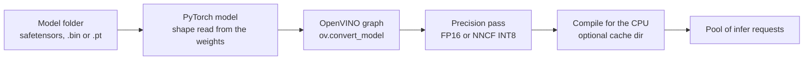
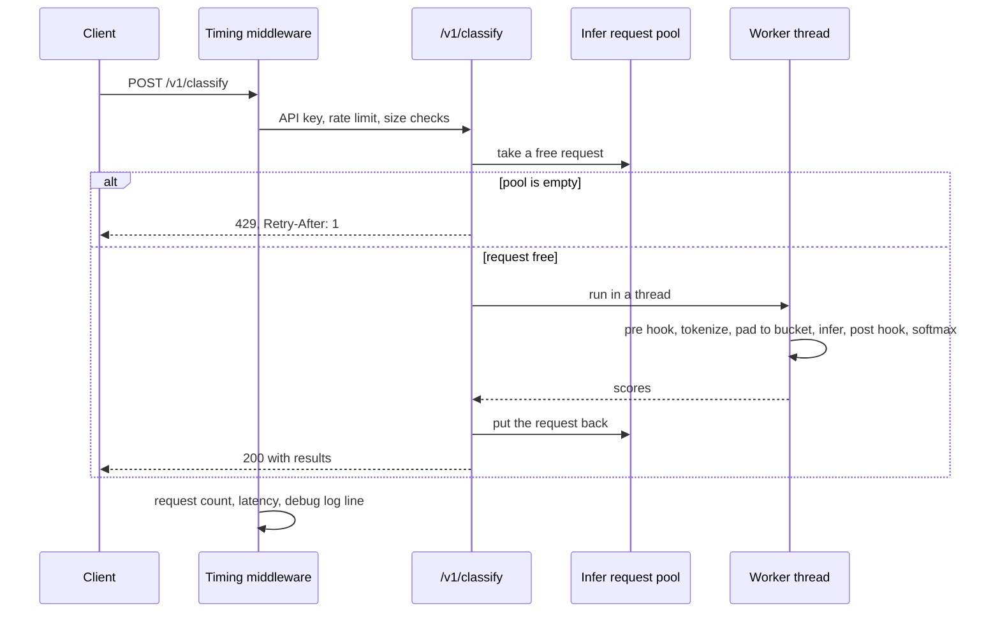

# cybertron


cybertron serves a local Hugging Face encoder checkpoint on CPU through OpenVINO. It has two inference routes, `/v1/classify` and `/v1/embed`. The tests cover BERT, DistilBERT, RoBERTa, and MiniLM-sized BERT checkpoints.

At startup the service converts the PyTorch model to OpenVINO, stores the weights as FP32, FP16, or INT8, and compiles the model for the CPU. A fixed pool of OpenVINO infer requests serves the traffic. When every request in the pool is busy, the service answers `429` at once. It does not queue the request.

## How it works

Startup runs once. If a step fails, the service does not start.



Each inference request takes one infer request from the pool, or gets `429` at once:



## Quickstart

You need [uv](https://docs.astral.sh/uv/) and Python 3.10 or later.

```sh
uv sync
uv run huggingface-cli download distilbert/distilbert-base-uncased-finetuned-sst-2-english \
    --include "*.json" "*.txt" "model.safetensors" --local-dir models/sst2
CYBERTRON_MODEL=models/sst2 uv run uvicorn cybertron.main:create_app --factory --port 8000
```

Run one uvicorn worker per container. Each worker loads its own copy of the model and its own request pool.

To run the tests, use this command. The tests build tiny random models and need no network:

```sh
HF_HUB_OFFLINE=1 uv run pytest -q
```

The memory test is slow and is off by default. To run it, add `-m slow`.

## Docker

The image reads the model from `/model` and writes compiled blobs to `/cache`:

```sh
docker build -t cybertron .
docker run -p 8000:8000 -v "$PWD/models/sst2:/model:ro" -v cybertron-cache:/cache cybertron
```

The image keeps torch, because the service converts the model at each start. With a warm `/cache`, OpenVINO skips the compile step.

## Requests

Classify:

```sh
curl -s localhost:8000/v1/classify -H 'content-type: application/json' \
    -d '{"texts": ["I liked it", "too slow"], "top_k": 2}'
```

```json
{"results": [[{"label": "POSITIVE", "score": 0.9998}, {"label": "NEGATIVE", "score": 0.0002}], [...]]}
```

`top_k` defaults to 1. The service returns at most one entry per label. Single-label heads use softmax. Heads with `problem_type: multi_label_classification` use a sigmoid per label.

Embed:

```sh
curl -s localhost:8000/v1/embed -H 'content-type: application/json' \
    -d '{"texts": ["I liked it"], "pooling": "mean", "normalize": true}'
```

`pooling` is `mean` (masked mean over tokens) or `cls` (first token). `normalize` scales each vector to unit length. Pooled output is a good sentence embedding only when the checkpoint was trained for it.

Both routes take an optional `meta` list with one object per text. The service passes `meta` to the hooks and does not read it.

Other routes:

| Route | Use |
| --- | --- |
| `GET /health` | Liveness. Returns the resolved OpenVINO settings, the pool size, and the buckets. |
| `GET /health/deep` | Runs one inference on a request kept apart from the pool. Answers while the pool is busy. A second probe that overlaps a running one gets `429`. |
| `GET /metrics` | Prometheus metrics: `cybertron_requests_total`, `cybertron_request_seconds`, `cybertron_texts_total`, and `cybertron_free_slots`. |

## Model directory

`CYBERTRON_MODEL` points to a directory with `config.json`, the tokenizer files, and one weights file: `model.safetensors`, `pytorch_model.bin`, or a `*.pt` state dict. The service loads `.pt` and `.bin` files with `weights_only=True`, so it does not run pickled code. It never runs remote code.

The service accepts three weight layouts:

| Layout | Detected by | Routes |
| --- | --- | --- |
| Native classification head | `config.architectures` ends in `ForSequenceClassification` | classify, embed |
| No head | any other encoder `config.json` | embed |
| Custom head | keys start with `backbone.` and `classifier.N.` | classify, embed |

In the custom layout, `backbone.*` holds the `AutoModel` weights. `classifier.N.weight` and `classifier.N.bias` hold the Linear layers of an `nn.Sequential` head that reads the first token. The service gets the layer sizes from the tensor shapes and the positions from `N`. Set one activation per hidden layer in `config.json`. The default is `relu`. You can also use `gelu`, `tanh`, or `silu`:

```json
{"engine_head": {"activations": ["gelu"]}}
```

Labels come from `config.id2label`. To replace them, set `CYBERTRON_LABELS='["a", "b"]'`.

The service stops at startup when one of these is true:

- The config is a decoder or an encoder-decoder.
- The tokenizer has more tokens than the embedding table.
- The head is a regression head (`num_labels` is 1, or `problem_type` is `regression`).
- Head weights are missing.
- The label count does not match the head width.
- The weights have an unknown layout.

The model inputs come from the converted graph. The service sends `token_type_ids` only when the model has that input and the tokenizer makes it.

## Hooks

Set `CYBERTRON_HOOKS` to an importable module name. The module can define one or both functions:

```python
def pre(texts: list[str], meta: list[dict] | None) -> list[str]: ...
def post(logits: numpy.ndarray, meta: list[dict] | None, labels: list[str]) -> numpy.ndarray: ...
```

The defaults in `cybertron/services/preprocessing.py` and `cybertron/services/postprocessing.py` pass the input through unchanged. `pre` runs before tokenizing, on both routes, and must return one string per text. `post` runs on the classify logits, before softmax or sigmoid. To remove a label from a row, set its logit to `-inf`. After `post`, the request fails if a logit is NaN or `+inf`, or if a row has no finite logit.

`examples/hooks.py` masks runs of six or more digits and removes the labels that a row lists in `meta[i]["deny"]`:

```sh
CYBERTRON_HOOKS=examples.hooks CYBERTRON_MODEL=models/sst2 uv run uvicorn cybertron.main:create_app --factory
```

Hooks run in the service process with its permissions.

## Access control and limits

`/v1/*` routes check, in this order:

1. The API key, when `CYBERTRON_API_KEY` is set. Clients send it in `X-API-Key`. A wrong or missing key gets `401`.
2. The rate limit, when `CYBERTRON_RATE_LIMIT` is above 0. It counts requests per client address in a fixed window of `CYBERTRON_RATE_WINDOW` seconds.
3. The size limits. More than `CYBERTRON_MAX_TEXTS` texts, or a text longer than `CYBERTRON_MAX_CHARS` characters, gets `413`. A `meta` list of the wrong length gets `422`.
4. Admission. With no free infer request, the client gets `429` with `Retry-After: 1`.

`/health`, `/health/deep`, and `/metrics` need no key.

The rate limit uses the socket peer address. The service does not read `X-Forwarded-For`. Behind a load balancer, start uvicorn with `--proxy-headers --forwarded-allow-ips=LB_ADDRESS`, where `LB_ADDRESS` is the address of your load balancer. Then uvicorn sets the client address from the trusted proxy header.

Texts longer than the model limit are cut at `max_len` tokens. The service does not split them.

## Layout

```text
cybertron/
  main.py                  app factory, lifespan, routers
  core/
    config.py              settings from CYBERTRON_ environment variables
    logging_setup.py       the cybertron logger
    middlewares.py         request timing, metrics, and request log
    security.py            API key and rate limit
    concurrency.py         admission to the infer request pool
    memory_utils.py        GC freeze, thresholds, and periodic collection
  schemas/
    requests.py            request bodies
    responses.py           response bodies
  routes/
    inference.py           /v1/classify, /v1/embed
    health.py              /health, /health/deep
    metrics.py             /metrics
  services/
    model.py               load the checkpoint and read its shape
    convert.py             convert to OpenVINO, set precision, compile
    engine.py              tokenize, batch, infer
    preprocessing.py       default pre hook and its checks
    postprocessing.py      default post hook, checks, softmax, and top-k
```

## Settings

All settings are environment variables with the `CYBERTRON_` prefix. See [docs/tuning.md](docs/tuning.md) for each setting, its effect, and measured numbers. `CYBERTRON_LOG_LEVEL` sets the log level, `INFO` by default.
